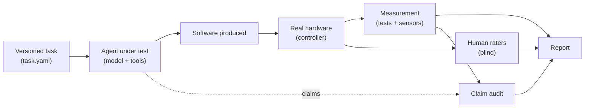

# HPIB — Human-Centered Physical Interaction Benchmark

**An open benchmark that measures whether an AI builds interactive physical experiences that work on real hardware and feel right to people — not just code that compiles.**

**English** · [Português (Brasil)](README.pt-BR.md)

> **Status: v0.2 (draft), concept phase.** This repository holds the specification and the evaluation kit. There is no reference application, no results and no scientific validation yet. Metrics, weights and thresholds are proposals to be calibrated in a pilot.

## At a glance

| | |
|---|---|
| **Question** | Can an AI turn a specification into a working physical experience, test it, fix its own mistakes and **prove** it works? |
| **Gap** | Code benchmarks measure whether code passes software tests. Few require proof on real hardware and human evaluation of the experience ([related work](docs/en/PROPOSAL.md#7-related-work)). |
| **Method** | Verification ladder V0–V4, blind human evaluation and an audit of the AI's own claims. |
| **First module** | **GCEB** — game controllers, haptics and audio (Linux as reference platform). |
| **Intended use** | Company teams run the kit **internally** against their own models and agents. |
| **Out of scope** | Device certification, clinical efficacy, public product rankings. |

## How the parts fit together

The unit under test is the **agent** (model + tools + budget), not the bare model.

## Core principle: the verification ladder

> Generated code ≠ proven operation ≠ good experience.

Each requirement demands a minimum level of evidence. A capability counts only at the level for which evidence is recorded.

| Level | Name | Accepted evidence | Example |
|---|---|---|---|
| **V0** | Simulated | Event in the simulation log | `terrain_changed` emitted |
| **V1** | Commanded | Command sent and the API returned success | `haptic_command result=sent` |
| **V2** | Device-observed | Data originating from the device itself | Input reading, returned state |
| **V3** | Physically measured | External sensor confirms response and timing | Accelerometer or contact microphone captures the vibration |
| **V4** | Human-perceived | Blind raters confirm the sensation | "Gravel" distinguishable from "asphalt" |

## What is in this repository

| Path | Content |
|---|---|
| [`docs/en/PROPOSAL.md`](docs/en/PROPOSAL.md) | Proposal for companies: problem, benefit, what to do internally |
| [`docs/en/FRAMEWORK.md`](docs/en/FRAMEWORK.md) | HPIB principles, layers and verification ladder |
| [`docs/en/GCEB-SPEC.md`](docs/en/GCEB-SPEC.md) | Technical specification of the GCEB module and the Terrain Feedback Challenge |
| [`docs/en/SCORING.md`](docs/en/SCORING.md) | Gates, dimensions, formulas and statistics |
| [`docs/en/HUMAN-EVALUATION.md`](docs/en/HUMAN-EVALUATION.md) | Blind human-evaluation protocol |
| [`docs/en/HARDWARE-COMPATIBILITY.md`](docs/en/HARDWARE-COMPATIBILITY.md) | Capabilities per device and the adapter contract |
| [`docs/en/INTERNAL-RUN-GUIDE.md`](docs/en/INTERNAL-RUN-GUIDE.md) | Step-by-step for an internal run |
| [`docs/en/SAFETY-AND-ETHICS.md`](docs/en/SAFETY-AND-ETHICS.md) | Hardware, generated-code and participant safety |
| [`docs/en/ROADMAP.md`](docs/en/ROADMAP.md) | Phases and proposed decisions (D-01 to D-12) |
| [`tasks/terrain-feedback/task.yaml`](tasks/terrain-feedback/task.yaml) | First task, machine-readable |
| [`schemas/`](schemas/) | JSON Schemas for telemetry, capabilities and completion report |
| [`templates/`](templates/) · [`examples/`](examples/) | Run manifest, human form, report template and examples |
| [`CHANGELOG.md`](CHANGELOG.md) | What changed from v0.1 and why |

## For companies: how to use it internally

1. Read the [proposal](docs/en/PROPOSAL.md) (5 minutes).
2. Set up the environment described in the [run guide](docs/en/INTERNAL-RUN-GUIDE.md).
3. Run the task with your agent configuration, filling in the manifest.
4. Run tests, measurement and blind human evaluation.
5. Produce the report and classify the conformance level (C0, C1 or C2).

You do not need to send us anything. Data, code and results stay with you.

## Honest limits

- There is no reference implementation yet; it is Phase 2 of the [roadmap](docs/en/ROADMAP.md).
- Human evaluation is noisy by nature, so the protocol requires a panel, anchors and an agreement measure.
- Results depend on hardware, so scoring is conditioned on the device's verified capabilities.
- Without a measurement rig (V3), results are not comparable with those obtained with one.

## Contributing and license

See [`CONTRIBUTING.md`](CONTRIBUTING.md). Licensed under the [Apache License 2.0](LICENSE) (decision D-01), covering code, schemas, documents and tasks.

## Notices

HPIB is an independent project with no affiliation with the manufacturers mentioned. Steam Controller, Valve, DualSense, PlayStation, Sony and other names are trademarks of their respective owners, used only to identify devices. An HPIB score does not certify a product or demonstrate clinical efficacy.

**Contact:** Nycollas Augusto Modesto de Carvalho, <nycollas_augusto@hotmail.com>
