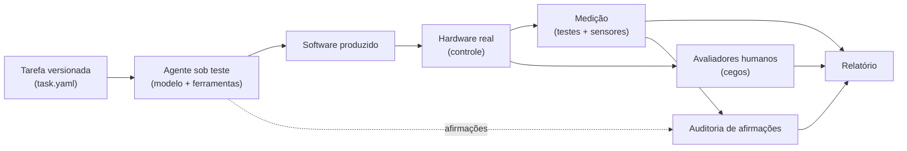

# HPIB — Human-Centered Physical Interaction Benchmark

**Benchmark aberto para medir se uma IA constrói experiências físicas interativas que funcionam no hardware e são boas para pessoas — e não apenas código que compila.**

[English](README.md) · **Português (Brasil)**

> **Status: v0.2 (rascunho), fase de concepção.** Este repositório contém a especificação e o kit de avaliação. Ainda não há aplicação de referência, resultados nem validação científica. Métricas, pesos e limiares são propostas sujeitas à calibração em piloto.

## Em uma tela

| | |
|---|---|
| **Pergunta** | Uma IA consegue transformar uma especificação em uma experiência física funcional, testá-la, corrigir os próprios erros e **provar** que funciona? |
| **Lacuna** | Benchmarks de código medem se o código passa em testes de software. Poucos exigem prova em hardware real e avaliação humana da experiência ([trabalhos relacionados](docs/pt-BR/PROPOSAL.md#7-trabalhos-relacionados)). |
| **Método** | Escada de verificação V0–V4, avaliação humana cega e auditoria das afirmações da própria IA. |
| **Módulo inicial** | **GCEB** — controles de videogame, háptica e áudio (Linux como plataforma de referência). |
| **Uso pretendido** | Equipes de empresas executam o kit **internamente** contra seus próprios modelos e agentes. |
| **Fora de escopo** | Certificação de dispositivos, eficácia clínica, ranking público de produtos. |

## Como as partes se encaixam

A unidade avaliada é o **agente** (modelo + ferramentas + orçamento), não o modelo isolado.

## Princípio central: a escada de verificação

> Código gerado ≠ funcionamento comprovado ≠ boa experiência.

Cada requisito exige um nível mínimo de evidência. Um recurso só conta no nível em que há evidência registrada.

| Nível | Nome | Evidência aceita | Exemplo |
|---|---|---|---|
| **V0** | Simulado | Evento no log da simulação | `terrain_changed` emitido |
| **V1** | Comandado | Comando enviado e API retornou sucesso | `haptic_command result=sent` |
| **V2** | Observado no dispositivo | Dado originado no próprio dispositivo | Leitura de entrada, estado devolvido |
| **V3** | Medido fisicamente | Sensor externo confirma resposta e tempo | Acelerômetro ou microfone de contato captura a vibração |
| **V4** | Percebido por humanos | Avaliadores cegos confirmam a sensação | "Cascalho" distinguível de "asfalto" |

## O que há neste repositório

| Caminho | Conteúdo |
|---|---|
| [`docs/pt-BR/PROPOSAL.md`](docs/pt-BR/PROPOSAL.md) | Proposta para empresas: problema, benefício, o que fazer internamente |
| [`docs/pt-BR/FRAMEWORK.md`](docs/pt-BR/FRAMEWORK.md) | Princípios, camadas e escada de verificação do HPIB |
| [`docs/pt-BR/GCEB-SPEC.md`](docs/pt-BR/GCEB-SPEC.md) | Especificação técnica do módulo GCEB e do Terrain Feedback Challenge |
| [`docs/pt-BR/SCORING.md`](docs/pt-BR/SCORING.md) | Portões, dimensões, fórmulas e estatística |
| [`docs/pt-BR/HUMAN-EVALUATION.md`](docs/pt-BR/HUMAN-EVALUATION.md) | Protocolo de avaliação humana cega |
| [`docs/pt-BR/HARDWARE-COMPATIBILITY.md`](docs/pt-BR/HARDWARE-COMPATIBILITY.md) | Capacidades por dispositivo e contrato do adaptador |
| [`docs/pt-BR/INTERNAL-RUN-GUIDE.md`](docs/pt-BR/INTERNAL-RUN-GUIDE.md) | Passo a passo para uma execução interna |
| [`docs/pt-BR/SAFETY-AND-ETHICS.md`](docs/pt-BR/SAFETY-AND-ETHICS.md) | Segurança de hardware, de código gerado e de participantes |
| [`docs/pt-BR/ROADMAP.md`](docs/pt-BR/ROADMAP.md) | Fases e decisões propostas (D-01 a D-12) |
| [`tasks/terrain-feedback/task.yaml`](tasks/terrain-feedback/task.yaml) | Primeira tarefa, legível por máquina |
| [`schemas/`](schemas/) | Esquemas JSON de telemetria, capacidades e relatório de conclusão |
| [`templates/`](templates/) · [`examples/`](examples/) | Manifesto de execução, formulário humano, relatório e exemplos |
| [`CHANGELOG.md`](CHANGELOG.md) | O que mudou em relação à v0.1 e por quê |

## Para empresas: como usar internamente

1. Leia a [proposta](docs/pt-BR/PROPOSAL.md) (5 minutos).
2. Monte o ambiente descrito no [guia de execução](docs/pt-BR/INTERNAL-RUN-GUIDE.md).
3. Execute a tarefa com a sua configuração de agente, preenchendo o manifesto.
4. Rode testes, medição e avaliação humana cega.
5. Gere o relatório e classifique o nível de conformidade (C0, C1 ou C2).

Você não precisa nos enviar nada. Dados, código e resultados permanecem com você.

## Limites honestos

- Não há implementação de referência ainda; ela é a Fase 2 do [roadmap](docs/pt-BR/ROADMAP.md).
- A avaliação humana é ruidosa por natureza; por isso o protocolo exige painel, âncoras e medida de concordância.
- Os resultados dependem do hardware. Por isso a pontuação é condicionada às capacidades verificadas do dispositivo.
- Sem uma bancada de medição (V3), os resultados não são comparáveis aos obtidos com ela.

## Contribuir e licença

Ver [`CONTRIBUTING.md`](CONTRIBUTING.md). Licenciado sob a [Apache License 2.0](LICENSE) (decisão D-01), cobrindo código, esquemas, documentos e tarefas.

## Avisos

HPIB é um projeto independente, sem vínculo com os fabricantes citados. Steam Controller, Valve, DualSense, PlayStation, Sony e demais nomes são marcas de seus respectivos titulares, usadas apenas para identificar dispositivos. Uma pontuação no HPIB não certifica produto nem demonstra eficácia clínica.

**Contato:** Nycollas Augusto Modesto de Carvalho, <nycollas_augusto@hotmail.com>
