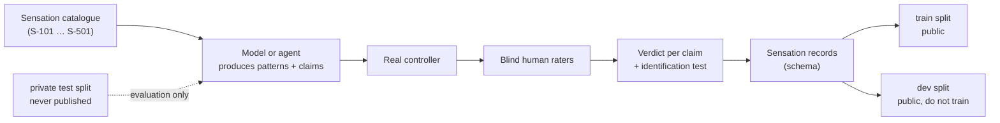

# HPIB-S — Sensation Challenge

**English** · [Português (Brasil)](README.pt-BR.md)

> **Status: draft (HPIB v0.2 line).** A proposal for labs. The catalogue, thresholds and data format are not calibrated, and there is no data and no result yet.

## At a glance

| | |
|---|---|
| **Question** | Can a model learn to produce haptic sensations on a game controller that people recognise as the intended sensation, not just code that sends a command? |
| **What a lab gets** | A [catalogue of sensations](SENSATION-CATALOG.md) with a human test for each, a [record format](data/sensation-record.schema.json) and public training data (once collected) |
| **What a lab returns** | Patterns (actuator command sequences) for each catalogue entry, plus a list of claims about how each one feels |
| **Who judges** | People, blind, on real hardware. Not the code, not the model |
| **Not** | A leaderboard of products, a device certification, or a clinical claim |

## How the parts fit together

## Data stays separated

The benchmark tasks carry a canary string and must never enter training. The challenge needs data that **is** meant for training. They never share files.

| Split | Purpose | Published | May be used for training |
|---|---|---|---|
| `train` | Teach the sensations | Yes | **Yes** |
| `dev` | Self-check and tuning by the lab | Yes | No |
| `private-test` | Official evaluation | **No**, held by the maintainer or a third party | No |
| Benchmark tasks (`tasks/`) | Measure agents | Public development set only | **No** (canary) |

A record belongs to exactly one split. A sensation design that was judged in `private-test` never moves to `train`.

## Levels

| Level | Content | Human test |
|---|---|---|
| 1 | Surfaces | Blind identification (H-ID), chance 20% for five surfaces |
| 2 | Impacts and one-off events | Claim veracity |
| 3 | Continuous states (engine, slip, weather) | Naturalness (C4) and comfort (C5) |
| 4 | Narrative cues (danger, reward, tension) | Does it convey what was intended (C1) |
| 5 | Portability to a second device class | The sensation still matches the claim |

Details per entry: [`SENSATION-CATALOG.md`](SENSATION-CATALOG.md). Scales and protocol: [`docs/en/HUMAN-EVALUATION.md`](../docs/en/HUMAN-EVALUATION.md).

## How a lab takes part

| Step | What happens |
|---|---|
| 1 | Pick levels and a device. Record its capabilities with [`capability-descriptor.schema.json`](../schemas/capability-descriptor.schema.json) |
| 2 | For each catalogue entry, produce a pattern and write one claim: "this feels like …" |
| 3 | State the verification level reached for each claim (V0–V4). Without hardware the honest maximum is **V1** |
| 4 | People rate the patterns blind on a real device. Verdicts per claim: `confirmed`, `partial`, `refuted`, `not_perceivable`, `not_testable` |
| 5 | Results are stored as [sensation records](data/sensation-record.schema.json) in the right split |

## Rules

1. **Claims must be honest.** Claiming a level above the evidence counts against the lab. Saying `unverified` does not.
2. **Safety.** Respect documented actuator limits, keep every pattern interruptible, return to a safe state on disconnect, never change firmware. See [`SAFETY-AND-ETHICS`](../docs/en/SAFETY-AND-ETHICS.md).
3. **Raters.** Consent is required. Any rater may flag discomfort and stop. Personal data is minimal and pseudonymised.
4. **No leakage.** Raters do not know which lab or model produced a build.
5. **Pace of change.** Released catalogue versions are immutable; changes create a new version.

## Honest limits

- No data has been collected. The catalogue is a proposal to be criticised.
- A 2-motor rumble device cannot render fine texture. Entries say which capability they need, and verdicts of `not_perceivable` are valid.
- Human judgement is noisy. The protocol needs a panel (≥ 5) and an agreement measure.
- A data licence is not decided yet. Proposal: CC BY 4.0 for records, Apache-2.0 for code and specifications (the repository licence).
