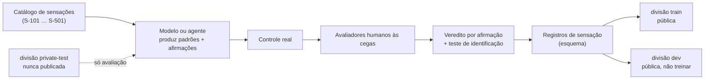

# HPIB-S — Desafio de Sensações

[English](README.md) · **Português (Brasil)**

> **Status: rascunho (linha HPIB v0.2).** Proposta para laboratórios. O catálogo, os limites e o formato de dados não estão calibrados, e ainda não há dados nem resultados.

## Em uma tabela

| | |
|---|---|
| **Pergunta** | Um modelo consegue aprender a produzir, num controle de videogame, sensações hápticas que as pessoas reconhecem como a sensação pretendida, e não só código que envia um comando? |
| **O que o laboratório recebe** | Um [catálogo de sensações](SENSATION-CATALOG.pt-BR.md) com um teste humano para cada uma, um [formato de registro](data/sensation-record.schema.json) e dados públicos de treino (quando coletados) |
| **O que o laboratório devolve** | Padrões (sequências de comandos de atuador) para cada entrada do catálogo, mais uma lista de afirmações sobre como cada uma é sentida |
| **Quem julga** | Pessoas, às cegas, em hardware real. Nem o código, nem o modelo |
| **Não é** | Ranking de produtos, certificação de dispositivo nem afirmação clínica |

## Como as partes se encaixam

## Os dados ficam separados

As tarefas do benchmark têm um código canary e nunca devem entrar em treino. O desafio precisa de dados que **são** feitos para treino. Os dois nunca compartilham arquivos.

| Divisão | Finalidade | Publicada | Pode ser usada em treino |
|---|---|---|---|
| `train` | Ensinar as sensações | Sim | **Sim** |
| `dev` | Autoverificação e ajuste pelo laboratório | Sim | Não |
| `private-test` | Avaliação oficial | **Não**, guardada pelo mantenedor ou por terceiro | Não |
| Tarefas do benchmark (`tasks/`) | Medir agentes | Só o conjunto público de desenvolvimento | **Não** (canary) |

Cada registro pertence a uma única divisão. Um padrão julgado em `private-test` nunca passa para `train`.

## Níveis

| Nível | Conteúdo | Teste humano |
|---|---|---|
| 1 | Superfícies | Identificação às cegas (H-ID), acaso de 20% para cinco superfícies |
| 2 | Impactos e eventos pontuais | Veracidade da afirmação |
| 3 | Estados contínuos (motor, derrapagem, clima) | Naturalidade (C4) e conforto (C5) |
| 4 | Cues narrativos (perigo, recompensa, tensão) | Transmite o que se pretendia (C1) |
| 5 | Portabilidade para uma segunda classe de dispositivo | A sensação continua correspondendo à afirmação |

Detalhes por entrada: [`SENSATION-CATALOG.pt-BR.md`](SENSATION-CATALOG.pt-BR.md). Escalas e protocolo: [`docs/pt-BR/HUMAN-EVALUATION.md`](../docs/pt-BR/HUMAN-EVALUATION.md).

## Como um laboratório participa

| Etapa | O que acontece |
|---|---|
| 1 | Escolher níveis e um dispositivo. Registrar as capacidades dele com [`capability-descriptor.schema.json`](../schemas/capability-descriptor.schema.json) |
| 2 | Para cada entrada do catálogo, produzir um padrão e escrever uma afirmação: "isto é sentido como …" |
| 3 | Declarar o nível de verificação atingido em cada afirmação (V0–V4). Sem hardware, o máximo honesto é **V1** |
| 4 | Pessoas avaliam os padrões às cegas num dispositivo real. Vereditos por afirmação: `confirmed`, `partial`, `refuted`, `not_perceivable`, `not_testable` |
| 5 | Os resultados são guardados como [registros de sensação](data/sensation-record.schema.json) na divisão correta |

## Regras

1. **Afirmações honestas.** Declarar um nível acima da evidência conta contra o laboratório. Dizer `unverified` não.
2. **Segurança.** Respeitar os limites documentados do atuador, manter todo padrão interrompível, voltar a um estado seguro na desconexão, nunca alterar firmware. Ver [`SAFETY-AND-ETHICS`](../docs/pt-BR/SAFETY-AND-ETHICS.md).
3. **Avaliadores.** O consentimento é obrigatório. Qualquer avaliador pode sinalizar desconforto e parar. Dados pessoais mínimos e pseudonimizados.
4. **Sem vazamento.** Os avaliadores não sabem qual laboratório ou modelo produziu cada versão.
5. **Mudanças.** Versões publicadas do catálogo são imutáveis; mudanças criam uma nova versão.

## Limites honestos

- Nenhum dado foi coletado. O catálogo é uma proposta para ser criticada.
- Um controle de 2 motores não reproduz textura fina. As entradas dizem qual capacidade exigem, e o veredito `not_perceivable` é válido.
- O julgamento humano é ruidoso. O protocolo exige um painel (≥ 5) e uma medida de concordância.
- A licença dos dados ainda não foi decidida. Proposta: CC BY 4.0 para os registros e Apache-2.0 para código e especificações (a licença do repositório).
