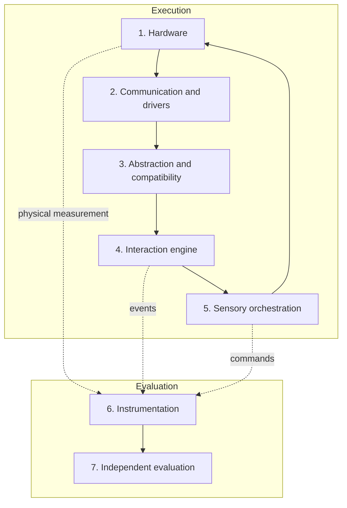

# HPIB — Framework

**Version:** 0.2 (draft) · Consolidates the principles and architecture of the v0.1 concept document.

## 1. Overview

HPIB evaluates the ability of AI agents to develop systems that connect **software, hardware, sensors, actuators and human perception**. GCEB (game controllers) is the first module; the architecture is designed to accept others.

Layers 1–5 belong to the solution built by the agent. Layers 6–7 belong to the benchmark and **must not** be modifiable by the agent.

## 2. Layers

| # | Layer | Responsibility | Examples |
|---|---|---|---|
| 1 | Hardware | Physical devices | Sticks, vibration motors, triggers, sensors |
| 2 | Communication and drivers | Data transport | USB, Bluetooth, HID, evdev |
| 3 | Abstraction and compatibility | Expose capabilities and limits; separate common from proprietary features | Capability descriptor |
| 4 | Interaction engine | Interpret inputs and application state | Terrain, collisions, simulation states |
| 5 | Sensory orchestration | Coordinate vibration, audio, visuals and timing without actuator conflicts | Effect queue with limits |
| 6 | Instrumentation | Record events, latency, errors and states | JSONL telemetry, measurement rig |
| 7 | Independent evaluation | Consolidate technical and human results and produce the report | Scoring, claim audit |

Flow: Hardware → Drivers → Abstraction → Application state → Orchestration → Physical response → Measurement → Validation.

## 3. Principles

| Principle | Operational rule |
|---|---|
| Real operation | A requirement counts at the evidence level (V0–V4) actually recorded |
| Human validation | The experience is assessed by people when part of the requirements; the human score never replaces technical tests |
| Reproducibility | Another evaluator repeats the test from the manifest and artifacts |
| Transparency | Limitations, dependencies, interventions and failures are documented |
| Neutrality | No model or manufacturer gets an advantage; the unit evaluated is the agent configuration |
| Portability | Adapters per device and OS; compatibility measured **per feature** |
| Safety | Risky tasks run in a controlled setting; see [SAFETY-AND-ETHICS](SAFETY-AND-ETHICS.md) |
| Accessibility | Tests consider sensory and motor differences |
| Incremental evolution | New categories do not invalidate earlier evaluations (immutable versions) |

## 4. Verification ladder (V0–V4)

See the table in the [README](../../README.md#core-principle-the-verification-ladder). Rules:

1. A command sent (V1) never proves the physical response (V3).
2. Each requirement declares a `required_level` and, when it depends on a measurement rig, a `fallback_level`.
3. An unavailable feature is recorded as `unsupported` or `unavailable`; it is never silently simulated.

## 5. Unit under test

Results describe an **agent configuration**: model and version, tools, permissions, network access, time and token budget, and human interventions. Changing any item creates a different configuration.

## 6. Expansions (exploratory, out of scope for v0.x)

| Domain | Possible use | Limit |
|---|---|---|
| Robotics | Interfaces, telemetry, tactile force feedback, sensor diagnostics | Starts in simulation or low risk; real hardware requires limits, emergency stop and supervision |
| Medical research and rehabilitation | Simulator training, accessibility, haptic patterns | HPIB does **not** certify medical devices or demonstrate clinical efficacy. It requires its own protocol, qualified professionals, risk analysis, data protection and independent validation |

## 7. Out of scope

Device certification, clinical evaluation, public product rankings and universal controller compatibility.
