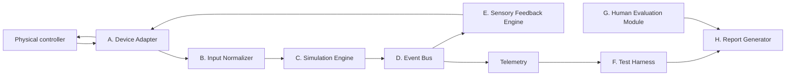

# GCEB — Technical specification v0.2 (draft)

| | |
|---|---|
| **Project / module** | HPIB / Game Controller Experience Benchmark (GCEB) |
| **Version** | 0.2.0 (draft). Supersedes v0.1 |
| **Initial platform** | PC, Linux first |
| **Languages** | English and Portuguese (Brazil), with equivalent content. Divergences are defects: open an issue |
| **Objective** | Assess whether an AI agent develops, tests, debugs and documents an interactive experience with a physical controller, and **proves** that it works |

## 1. v0.2 scope

| Category | Items |
|---|---|
| **Mandatory** | Controller detection · reading buttons, sticks and triggers · displaying values · connection state · interactive simulation · ≥ 5 terrains · collision events · event bus · event and failure logging · automated tests · agent completion report |
| **Optional (only with proven support)** | Contextual vibration · adaptive triggers · accelerometer and gyroscope · touchpad/trackpad · vendor features · integration with existing games and mods · local auxiliary services |
| **Out of scope** | Universal compatibility · all commercial games · proprietary features without access · physical robots · medical devices · clinical evaluation |

Optional never implies a penalty when the capability does not exist in the contracted profile.

## 2. Architecture

Separates controller communication, simulation logic, effect execution and evaluation.



| Component | Responsibility |
|---|---|
| A. Device Adapter | Identify the device and publish the capability descriptor ([schema](../../schemas/capability-descriptor.schema.json)) |
| B. Input Normalizer | Consistent representation of inputs, preserving raw values |
| C. Simulation Engine | State: speed, terrain, collisions, player actions. **Independent** of any actuator being present |
| D. Event Bus | Distributes events to audio, haptics, interface and telemetry |
| E. Sensory Feedback Engine | Converts semantic events into output commands compatible with the device |
| F. Test Harness | Runs T01–T12 and checks acceptance criteria. Belongs to the benchmark |
| G. Human Evaluation Module | Presents the protocol and records responses |
| H. Report Generator | Consolidates technical and human results |

## 3. Reference profile

Two tracks, because the technology choice determines which features are reachable.

| Track | Technology | Reaches | Cost |
|---|---|---|---|
| **W — Web** (mandatory) | Modern browser | Standard inputs and simple vibration (H1) | Simple, portable execution |
| **N — Native** (optional) | Desktop application | IMU, touchpad, adaptive triggers, vendor APIs (H2–H6) | Heavier setup |

The final decision is [D-03](ROADMAP.md#proposed-decisions), confirmed in Phase 1.

### Technical hypotheses to verify (Phase 1)

None is confirmed in this repository. Do not treat them as facts.

| ID | Hypothesis | State |
|---|---|---|
| H1 | The Gamepad API in Chromium-based browsers exposes vibration through `vibrationActuator`, but not adaptive triggers, IMU or touchpad | Unverified |
| H2 | WebHID in Chromium allows raw DualSense reports, with user permission | Unverified |
| H3 | The Linux kernel `hid-playstation` driver exposes DualSense vibration, LEDs, motion sensors and touchpad; adaptive triggers depend on user-space access | Partial; verify on the kernel version used |
| H4 | The Steam Controller (2026) appears as a basic gamepad at system level; trackpads, grips and other features require Steam Input | Reported ([GamingOnLinux, May 2026](https://www.gamingonlinux.com/2026/05/the-new-steam-controller-from-valve-is-out-now-some-early-thoughts/page=1)) after 5 days of testing; verify |
| H5 | SDL3 offers vibration, sensor reading and raw effect sending for some controllers | Unverified; confirm the current API |
| H6 | The DualSense high-definition haptics go through a USB audio endpoint | Unverified |

## 4. Capability rule

A feature is `supported` **only** when the adapter identifies it and performs a functional check.

| State | Meaning |
|---|---|
| `supported` | Identified and functionally verified |
| `unsupported` | The device does not have the feature |
| `unavailable` | The device has it, but this stack (driver, library, permission) cannot reach it |
| `unverified` | Declared, not yet functionally checked |

A missing feature is not a model failure if it is not part of the contracted profile. Declaring `supported` without verification is a failure in D3 and D5.

## 5. Reference challenge: Terrain Feedback Challenge

**Objective:** the user drives a vehicle on a test track and receives audiovisual and haptic responses tied to simulation events.

| Element | Definition |
|---|---|
| Surfaces | Asphalt, grass, sand, gravel, metal. Each with a stable identifier and configurable properties |
| Events | `surface_entered`, `surface_exited`, `speed_changed`, `collision`, `vehicle_stopped`, `controller_disconnected` |
| Requirements | R01–R16 and conditional extras X01–X02, in [`task.yaml`](../../tasks/terrain-feedback/task.yaml) |

Behaviour examples (there is no universal vibration pattern per terrain; patterns are documented and calibrated during implementation):

| Event or terrain | Expected response |
|---|---|
| Gravel | Irregular vibration pattern |
| Asphalt | Smooth continuous pattern or none, per configuration |
| Collision | Short impulse |
| High speed | Gradual modulation, if specified |
| Disconnect | Safe interruption of outputs |

### Simulation separated from hardware

The report always distinguishes four categories, mapped to the [verification ladder](FRAMEWORK.md#4-verification-ladder-v0v4):

| Category | Level |
|---|---|
| Simulated event | V0 |
| Command sent to the device | V1 |
| Verified physical response | V3 |
| Feature not available | — |

## 6. Task format

Each task has a versioned specification (fields of [`task.yaml`](../../tasks/terrain-feedback/task.yaml)):

`task_id` · `version` · `objective` · `environment` · `agent_budget` · `hardware_profile` · `measurement_rig` · `requirements` (with `mandatory`, `requires`, `required_level`, `fallback_level`, `tests`) · `acceptance_tests` · `human_protocol` · `safety_constraints` · `scoring` · `artifacts_required` · `held_out`

Requirements must be objective and verifiable, and distinguish mandatory from conditional.

## 7. Acceptance tests

The agent **delivers** automated tests. The benchmark harness runs the official tests, including the hidden ones of private variants.

| ID | Test | Criterion | Requirements |
|---|---|---|---|
| T01 | Initialisation | Starts without critical errors; environment version recorded | R04 |
| T02 | Device recognition | Device detected; valid capability descriptor | R01 |
| T03 | Input reading | Test inputs match received states. With a real device: V2; with replay of recorded reports: V0 (declare it) | R02, X01 |
| T04 | Terrain transition | Produces the correct event and updates state | R05, R06 |
| T05 | Feedback selection and controls | Each event uses the task profile; intensity and disable work | R07, R08, R15 |
| T06 | Collision | Event recorded and configured effects produced | R06 |
| T07 | Disconnect | Logs the failure, stops outputs, stays stable and handles reconnection | R03, R12 |
| T08 | Repeatability | Same scripted scenario twice: equivalent events and states within tolerances | R07, R16 |
| T09 | Unavailable features | Identifies the limitation and does not falsely claim execution | R13 |
| T10 | Logging and report | Telemetry valid against the schema; report exported | R14 |
| T11 | Physical measurement *(new)* | Rig confirms response and measures latency. Without a rig: fallback level | R09–R11, X02 |
| T12 | Safe state on abnormal termination *(new)* | On forced process kill or error, all outputs go to zero | R12 |

Numeric tolerances (latency, synchronisation) stay **undefined until the pilot** (decision D-05). Fixing them without measurement would be arbitrary.

## 8. Telemetry

It must allow reconstructing the event sequence without unnecessary personal data. Format: JSONL validated by [`telemetry-event.schema.json`](../../schemas/telemetry-event.schema.json).

Minimum fields: `t_mono_ns` (monotonic clock), `run_id`, `task_id`, `event`, `source`, `result`, `verification_level`; when applicable `clock_source`, `sim_state`, `capability`, `profile`, `error_code`.

Example ([full file](../../examples/telemetry-example.jsonl)):

```
event=terrain_changed    previous=asphalt current=gravel   result=ok         level=V0
event=haptic_command     profile=gravel                    result=sent       level=V1
event=haptic_verification profile=gravel                   result=unverified level=V1
```

The third line shows the essential distinction: **sending a command does not prove the physical response**. To measure latency, the software and rig clocks must be synchronised by a common marker.

## 9. Agent completion report

When finished, the agent delivers a [completion report](../../templates/completion-report.yaml) in which each claim states the requirement, the claimed level and the evidence. The audit compares claims with evidence to compute D5 ([SCORING](SCORING.md)).

## 10. v0.2 completion criteria

The version is considered implemented when:

1. The reference application runs as documented.
2. At least one reference device has a documented profile.
3. Tests T01–T12 are executable and results verifiable.
4. The terrain challenge produces reproducible events.
5. The system distinguishes a sent command from a verified physical response.
6. The V3 measurement rig is documented and prototyped.
7. The human protocol is documented and the pilot was run.
8. The report consolidates technical and human results.
9. Known limitations are recorded.

Completing the implementation does **not** mean scientific validation. That requires repeated experiments and consistency analysis.
