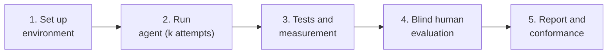

# Proposal: evaluate AI agents on physical experiences, internally

**Version:** 0.2 (draft) · **Audience:** evaluation, platform, SDK and accessibility teams

## 1. Summary

- **Problem:** an AI can deliver code that compiles and *claim* the experience works, when it neither works on the device nor feels right to the person using it.
- **Proposal:** an open, reproducible kit for you to measure this **inside your company**, with your models, your hardware and your raters.
- **Differentiator:** it demands evidence at five levels (V0–V4), uses blind human evaluation and audits whether what the agent claimed matches what was proven.

## 2. The problem and the gap

Programming benchmarks measure problem solving and passing software tests. Hardware integration produces failures those tests miss:

| Typical failure | Why it goes unnoticed |
|---|---|
| Haptic response inconsistent with the event | The command was sent; nobody measured the response |
| Perceptible delay between event and sensation | Shows only with external measurement or real use |
| A "implemented" feature the device does not offer | The agent simulated it without saying so |
| Vibration stuck after disconnect | No safe-state test |
| Technically correct but unpleasant effect | Only a person notices |

## 3. What HPIB is and is not

| It is | It is not |
|---|---|
| Specification, tasks, schemas and reproducible protocols | A hosted service or a public leaderboard |
| A kit for internal execution | A device or model certification |
| Starting with game controllers (GCEB) | A scientifically validated benchmark yet |

## 4. Why it matters to you

| If you are… | Value |
|---|---|
| **An AI lab** | Evaluates agents on real-hardware work; also measures completion honesty (D5), a common agent failure |
| **A manufacturer or platform** | Shows how well agents use your SDK and haptic features; exposes documentation and API gaps |
| **A game studio or accessibility team** | Measures whether AI can create usable haptic feedback and accessibility options |

## 5. What you would do internally

Details, roles and checklists: [INTERNAL-RUN-GUIDE.md](INTERNAL-RUN-GUIDE.md). A **minimal run** uses 1 task, 2 configurations, 3 attempts and 3 raters, without a measurement rig.

## 6. What this repository already delivers and what is missing

| Delivered | Missing (see [ROADMAP](ROADMAP.md)) |
|---|---|
| HPIB and GCEB specification | Reference application and test harness |
| `terrain-feedback` task in YAML, with 16 requirements, 2 conditional extras and 12 tests | Documented V3 measurement rig |
| Scoring with gates, formulas and statistics | Calibration of weights and thresholds in a pilot |
| Human protocol with anchors and an agreement measure | Verification of hardware features (Phase 1) |
| Schemas, templates and examples | Private task variants (held-out set) |

## 7. Related work

| Work | What it does | Difference from HPIB |
|---|---|---|
| Code benchmarks (for example SWE-bench, HumanEval) | Software tests over code | No hardware or human perception |
| IoT-SkillsBench ([arXiv:2603.19583](https://arxiv.org/abs/2603.19583), Mar 2026) | 42 embedded and IoT tasks validated on 3 real platforms and 23 peripherals | Focused on embedded systems; does not assess human experience or perceptual haptics |

To our knowledge, and subject to a systematic literature review not yet done, no public benchmark combines real hardware, perceptual haptics, blind human evaluation and claim auditing. References are welcome.

## 8. What we ask and what we do not

- **We ask:** technical feedback through issues; optionally, cite HPIB and use the report template if you publish results.
- **We do not ask:** exclusivity, data, code, or publication of results.

## 9. Risks and limitations

| Risk | Proposed mitigation |
|---|---|
| Human-evaluation noise | Panel, reference anchors, Krippendorff's α ([HUMAN-EVALUATION](HUMAN-EVALUATION.md)) |
| Hardware variation | Scoring conditioned on verified capabilities |
| Small samples | k ≥ 5 attempts and confidence intervals; no ranking over overlapping intervals |
| Memorisation of the public task | Private variants, parametric generation and a canary string |
| Internal runs not comparable | Conformance levels C0–C2 |

## 10. Contact

Nycollas Augusto Modesto de Carvalho, <nycollas_augusto@hotmail.com>
