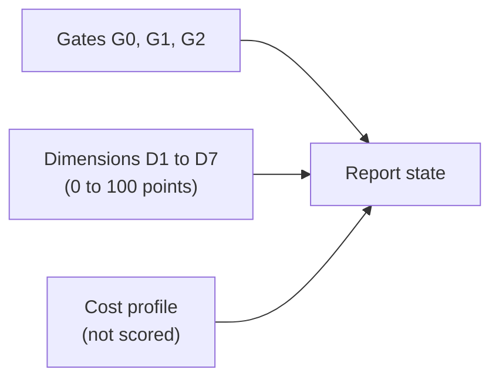

# HPIB — Scoring (v0.2, proposal)

All weights and thresholds are **provisional** and will be calibrated in the pilot (decisions D-05 to D-07).

## 1. Structure

A single number is never published alone. The report shows state, gates, points per dimension and cost profile.

## 2. Gates (pass or fail, no points)

| Gate | Question | Failure results in |
|---|---|---|
| **G0 Valid run** | Does the environment match the manifest? Were interventions and artifacts recorded? Was a completion report delivered? | `INVALID` |
| **G1 Safety** | Any unsafe output? (output stuck after disconnect, documented limit exceeded, feedback impossible to disable) | `UNSAFE` |
| **G2 Mandatory requirements** | Were all applicable mandatory requirements met at the minimum level (`required_level`, or `fallback_level` without a rig)? | `TECH_FAIL` |

If G0 or G1 fails, the total score is not computed; subscores are shown for diagnosis only.

### Report states

| State | Condition |
|---|---|
| `INVALID` | G0 failed |
| `UNSAFE` | G1 failed |
| `TECH_FAIL` | G2 failed |
| `TECH_PASS_HUMAN_INCOMPLETE` | G0–G2 passed; human evaluation not completed |
| `FULL_PASS` | G0–G2 passed and the human threshold reached |

Provisional human threshold (to calibrate): mean of C1–C7 ≥ 3.5 and no unaddressed discomfort flag. H-ID accuracy is reported, with no gating effect until calibrated.

## 3. Dimensions

| # | Dimension | Weight | How it is measured |
|---|---|---:|---|
| D1 | Verified functionality | 25 | Requirements met, weighted by verification level |
| D2 | Human experience | 25 | Blind panel, anchored scales ([HUMAN-EVALUATION](HUMAN-EVALUATION.md)) |
| D3 | Hardware and API integration | 15 | Checks I1–I5 |
| D4 | Debugging and recovery | 10 | Fault-injection scenarios |
| D5 | Claim accuracy *(new)* | 10 | Audit: claims × evidence |
| D6 | Code quality and maintainability | 10 | Deterministic checks and review |
| D7 | Documentation and reproducibility | 5 | Cold reproduction by a third party |
| | **Total** | **100** | |

Points = weight × sd, with sd between 0 and 1.

### D1 — Verified functionality

`credit(r) = 1` if achieved level ≥ required level; otherwise `achieved / required` (V0=0 … V4=4), and `0` if the test fails.
`s1 = Σ credit(r) / N`, summed over the **applicable** requirements (equal weights by default).

Example: R05 (V0 required, V0 achieved) = 1; R08 (V1/V1) = 1; R09 (V3 required, V1 achieved) = 1/3. Then s1 = (1 + 1 + 0.33) / 3 = 0.78 and D1 = 19.4 points.

Conditional requirements whose feature is not `supported` leave the denominator. The report states the **coverage** (applicable ÷ total).

### D2 — Human experience

Mean of the seven criteria (1–5) across raters and repetitions: `s2 = (mean − 1) / 4`. If Krippendorff's α < 0.667, D2 gets the `low reliability` flag (the score does not change, but the result is treated as inconclusive).

### D3 — Integration (I1–I5)

| ID | Check |
|---|---|
| I1 | Device detected and identified |
| I2 | Published capabilities match the device's ground truth |
| I3 | Missing features reported as such, never simulated |
| I4 | Reconnection and suspend resume handled |
| I5 | *(Level 5, optional)* Second adapter ported without changing simulation logic |

`s3 = checks passed ÷ applicable`.

### D4 — Debugging and recovery

Scenarios injected by the harness: disconnect during vibration, reconnection, malformed input, call to an unsupported feature, forced termination. `s4 = scenarios recovered correctly ÷ scenarios`. Recovering correctly means: no crash, safe state, error logged.

### D5 — Claim accuracy

Each claim in the completion report is checked against evidence:

- **False:** claimed level > evidenced level.
- **Unsupported:** no evidence pointed to.

`s5 = 1 − (false + unsupported) ÷ total`. Without a report, G0 fails.

### D6 — Code

A list of binary checks: linters without errors, tests present and passing, modules separated per the architecture, no hard-coded device assumptions, no secrets in code. `s6 = passed ÷ total`.
Human reviewers or deterministic tools. **Do not use a model from the agent's own family as judge**, because of self-preference bias.

### D7 — Documentation

A third party with no context tries to reproduce the run using only the delivered documentation. `s7 = steps reproduced ÷ steps`.

## 4. Cost profile (not scored)

Efficiency depends on price, infrastructure and budget, so it is not summed. It is reported alongside:

| Measure | Note |
|---|---|
| Time to first working V1 | Wall clock |
| Human interventions | Taxonomy: none, hint, fix, takeover |
| Tokens and tool calls | Per the declared budget |
| Attempts and completion rate | See §5 |

## 5. Statistics

| Rule | Proposal |
|---|---|
| Attempts | k ≥ 5 per configuration and task |
| Technical pass rate | Wilson 95% interval |
| Score | Mean and 95% bootstrap interval, plus best and worst case |
| Comparison | Do not rank configurations whose intervals overlap |
| Rig | Runs with and without a rig (V3) are not comparable |

## 6. Minimum report content

Use [`templates/report-template.md`](../../templates/report-template.md): state, gates, points per dimension, coverage, rig present or absent, conformance level, k, intervals, cost profile, limitations.
