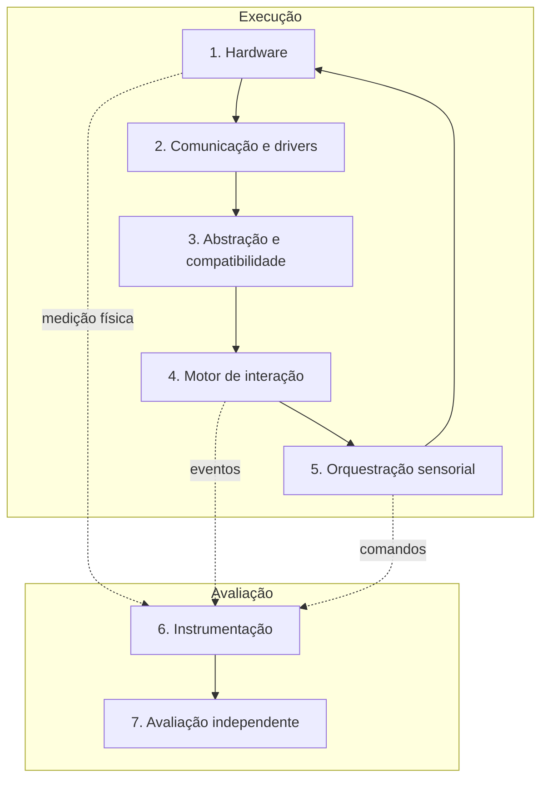

# HPIB — Framework

**Versão:** 0.2 (rascunho) · Consolida os princípios e a arquitetura do documento de concepção v0.1.

## 1. Visão geral

O HPIB avalia a capacidade de agentes de IA de desenvolver sistemas que ligam **software, hardware, sensores, atuadores e percepção humana**. O GCEB (controles de videogame) é o primeiro módulo; a arquitetura foi pensada para receber outros.

As camadas 1–5 pertencem à solução construída pelo agente. As camadas 6–7 pertencem ao benchmark e **não** podem ser alteradas pelo agente.

## 2. Camadas

| # | Camada | Responsabilidade | Exemplos |
|---|---|---|---|
| 1 | Hardware | Dispositivos físicos | Analógicos, motores de vibração, gatilhos, sensores |
| 2 | Comunicação e drivers | Transporte de dados | USB, Bluetooth, HID, evdev |
| 3 | Abstração e compatibilidade | Expor capacidades e limites; separar recursos comuns de proprietários | Descritor de capacidades |
| 4 | Motor de interação | Interpretar entradas e estado da aplicação | Terreno, colisões, estados de simulação |
| 5 | Orquestração sensorial | Coordenar vibração, áudio, visual e tempo, sem conflito entre atuadores | Fila de efeitos com limites |
| 6 | Instrumentação | Registrar eventos, latência, erros e estados | Telemetria JSONL, bancada de medição |
| 7 | Avaliação independente | Consolidar resultados técnicos e humanos e gerar o relatório | Pontuação, auditoria de afirmações |

Fluxo: Hardware → Drivers → Abstração → Estado da aplicação → Orquestração → Resposta física → Medição → Validação.

## 3. Princípios

| Princípio | Regra operacional |
|---|---|
| Funcionamento real | O requisito conta no nível de evidência (V0–V4) efetivamente registrado |
| Validação humana | A experiência é avaliada por pessoas quando faz parte dos requisitos; a nota humana não substitui testes técnicos |
| Reprodutibilidade | Outro avaliador repete o teste a partir do manifesto e dos artefatos |
| Transparência | Limitações, dependências, intervenções e falhas são documentadas |
| Neutralidade | Nenhum modelo ou fabricante recebe vantagem; a unidade avaliada é a configuração do agente |
| Portabilidade | Adaptadores por dispositivo e sistema; compatibilidade medida **por recurso** |
| Segurança | Tarefas de risco ocorrem em ambiente controlado; ver [SAFETY-AND-ETHICS](SAFETY-AND-ETHICS.md) |
| Acessibilidade | Os testes consideram diferenças sensoriais e motoras |
| Evolução incremental | Novas categorias não invalidam avaliações anteriores (versões imutáveis) |

## 4. Escada de verificação (V0–V4)

Ver a tabela no [README](../../README.pt-BR.md#princípio-central-a-escada-de-verificação). Regras:

1. Um comando enviado (V1) nunca comprova a resposta física (V3).
2. Cada requisito declara `required_level` e, quando depende de bancada de medição, um `fallback_level`.
3. Recurso não disponível é registrado como `unsupported` ou `unavailable`; nunca é simulado em silêncio.

## 5. Unidade avaliada

Resultados descrevem uma **configuração de agente**: modelo e versão, ferramentas, permissões, acesso à rede, orçamento de tempo e *tokens*, e intervenções humanas. Mudar qualquer item cria outra configuração.

## 6. Expansões (exploratórias, fora do escopo da v0.x)

| Domínio | Possível uso | Limite |
|---|---|---|
| Robótica | Interfaces, telemetria, feedback tátil de força, diagnóstico de sensores | Começa em simulação ou baixo risco; hardware real exige limites, parada de emergência e supervisão |
| Pesquisa médica e reabilitação | Treinamento em simulador, acessibilidade, padrões hápticos | O HPIB **não** certifica dispositivos médicos nem demonstra eficácia clínica. Exige protocolo próprio, profissionais qualificados, análise de risco, proteção de dados e validação independente |

## 7. Fora de escopo

Certificação de dispositivos, avaliação clínica, ranking público de produtos e compatibilidade universal com controles.
