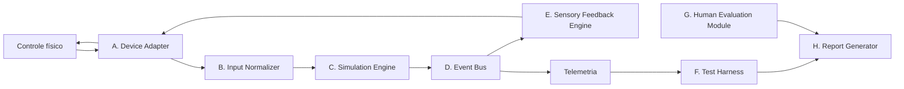

# GCEB — Especificação técnica v0.2 (rascunho)

| | |
|---|---|
| **Projeto / módulo** | HPIB / Game Controller Experience Benchmark (GCEB) |
| **Versão** | 0.2.0 (rascunho). Substitui a v0.1 |
| **Plataforma inicial** | PC, com prioridade para Linux |
| **Idiomas** | Português (Brasil) e inglês, com conteúdo equivalente. Divergências são defeitos: abra uma *issue* |
| **Objetivo** | Avaliar se um agente de IA desenvolve, testa, depura e documenta uma experiência interativa com controle físico, e se **prova** que ela funciona |

## 1. Escopo da v0.2

| Categoria | Itens |
|---|---|
| **Obrigatório** | Detecção de controles · leitura de botões, analógicos e gatilhos · visualização dos valores · estado de conexão · simulação interativa · ≥ 5 terrenos · eventos de colisão · barramento de eventos · registro de eventos e falhas · testes automatizados · relatório de conclusão do agente |
| **Opcional (só se houver suporte comprovado)** | Vibração contextual · gatilhos adaptáveis · acelerômetro e giroscópio · touchpad/trackpad · recursos de fabricante · integração com jogos existentes e *mods* · serviços auxiliares locais |
| **Fora de escopo** | Compatibilidade universal · todos os jogos comerciais · recursos proprietários sem acesso · robôs físicos · dispositivos médicos · avaliação clínica |

Opcional não implica penalidade quando o recurso não existe no perfil contratado.

## 2. Arquitetura

Separa comunicação com o controle, lógica da simulação, execução de efeitos e avaliação.



| Componente | Responsabilidade |
|---|---|
| A. Device Adapter | Identificar o dispositivo e publicar o descritor de capacidades ([schema](../../schemas/capability-descriptor.schema.json)) |
| B. Input Normalizer | Representação consistente das entradas, preservando valores originais |
| C. Simulation Engine | Estado: velocidade, terreno, colisões, ações do jogador. **Independente** de haver atuador |
| D. Event Bus | Distribui eventos para áudio, háptica, interface e telemetria |
| E. Sensory Feedback Engine | Converte eventos semânticos em comandos de saída compatíveis com o dispositivo |
| F. Test Harness | Executa T01–T12 e verifica critérios de aceitação. Pertence ao benchmark |
| G. Human Evaluation Module | Apresenta o protocolo e registra respostas |
| H. Report Generator | Consolida resultados técnicos e humanos |

## 3. Perfil de referência

Duas trilhas, porque a escolha tecnológica define quais recursos são alcançáveis.

| Trilha | Tecnologia | Alcança | Custo |
|---|---|---|---|
| **W — Web** (obrigatória) | Navegador moderno | Entradas padrão e vibração simples (H1) | Execução simples e portável |
| **N — Nativa** (opcional) | Aplicação desktop | IMU, touchpad, gatilhos adaptáveis, APIs de fabricante (H2–H6) | Configuração mais pesada |

A decisão definitiva é a [D-03](ROADMAP.md#decisões-propostas), confirmada na Fase 1.

### Hipóteses técnicas a verificar (Fase 1)

Nenhuma está confirmada neste repositório. Não as trate como fatos.

| ID | Hipótese | Estado |
|---|---|---|
| H1 | A Gamepad API em navegadores Chromium expõe vibração por `vibrationActuator`, mas não gatilhos adaptáveis, IMU nem touchpad | Não verificado |
| H2 | WebHID em Chromium permite relatórios brutos do DualSense, com permissão do usuário | Não verificado |
| H3 | O driver `hid-playstation` do kernel Linux expõe vibração, LEDs, sensores de movimento e touchpad do DualSense; gatilhos adaptáveis dependem de acesso em espaço de usuário | Parcial; verificar na versão do kernel usada |
| H4 | O Steam Controller (2026) aparece como gamepad básico no sistema; trackpads, grips e demais recursos exigem o Steam Input | Reportado ([GamingOnLinux, mai. 2026](https://www.gamingonlinux.com/2026/05/the-new-steam-controller-from-valve-is-out-now-some-early-thoughts/page=1)), após 5 dias de teste; verificar |
| H5 | SDL3 oferece vibração, leitura de sensores e envio de efeitos brutos para alguns controles | Não verificado; confirmar a API vigente |
| H6 | A háptica de alta definição do DualSense passa por um endpoint de áudio USB | Não verificado |

## 4. Regra de capacidade

Um recurso é `supported` **somente** quando o adaptador o identifica e executa uma verificação funcional.

| Estado | Significado |
|---|---|
| `supported` | Identificado e verificado funcionalmente |
| `unsupported` | O dispositivo não possui o recurso |
| `unavailable` | O dispositivo possui, mas esta pilha (driver, biblioteca, permissão) não alcança |
| `unverified` | Declarado, ainda sem verificação funcional |

A ausência de um recurso não é falha do modelo se ele não fizer parte do perfil contratado. Declarar `supported` sem verificação é falha de D3 e D5.

## 5. Desafio de referência: Terrain Feedback Challenge

**Objetivo:** o usuário conduz um veículo em uma pista de teste e recebe respostas audiovisuais e hápticas ligadas aos eventos da simulação.

| Elemento | Definição |
|---|---|
| Superfícies | Asfalto, grama, areia, cascalho, metal. Cada uma com identificador estável e propriedades configuráveis |
| Eventos | `surface_entered`, `surface_exited`, `speed_changed`, `collision`, `vehicle_stopped`, `controller_disconnected` |
| Requisitos | R01–R16 e extras condicionais X01–X02, em [`task.yaml`](../../tasks/terrain-feedback/task.yaml) |

Exemplos de comportamento (não há padrão universal de vibração por terreno; os padrões são documentados e calibrados na implementação):

| Evento ou terreno | Resposta esperada |
|---|---|
| Cascalho | Padrão vibratório irregular |
| Asfalto | Contínuo suave ou ausência, conforme configuração |
| Colisão | Impulso curto |
| Velocidade alta | Modulação gradual, se prevista |
| Desconexão | Interrupção segura das saídas |

### Simulação separada do hardware

O relatório distingue sempre quatro categorias, mapeadas na [escada de verificação](FRAMEWORK.md#4-escada-de-verificação-v0v4):

| Categoria | Nível |
|---|---|
| Evento simulado | V0 |
| Comando enviado ao dispositivo | V1 |
| Resposta física verificada | V3 |
| Recurso não disponível | — |

## 6. Formato das tarefas

Cada tarefa tem especificação versionada (campos de [`task.yaml`](../../tasks/terrain-feedback/task.yaml)):

`task_id` · `version` · `objective` · `environment` · `agent_budget` · `hardware_profile` · `measurement_rig` · `requirements` (com `mandatory`, `requires`, `required_level`, `fallback_level`, `tests`) · `acceptance_tests` · `human_protocol` · `safety_constraints` · `scoring` · `artifacts_required` · `held_out`

Requisitos precisam ser objetivos e verificáveis, e distinguir obrigatórios de condicionais.

## 7. Testes de aceitação

O agente **entrega** testes automatizados. O harness do benchmark executa os testes oficiais, incluindo os ocultos das variantes privadas.

| ID | Teste | Critério | Requisitos |
|---|---|---|---|
| T01 | Inicialização | Inicia sem erro crítico; versão do ambiente registrada | R04 |
| T02 | Reconhecimento do dispositivo | Dispositivo detectado; descritor de capacidades válido | R01 |
| T03 | Leitura de entradas | Entradas de teste correspondem aos estados recebidos. Com dispositivo real: V2; com reprodução de relatórios gravados: V0 (declarar) | R02, X01 |
| T04 | Transição de terreno | Gera o evento correto e atualiza o estado | R05, R06 |
| T05 | Seleção de feedback e controles | Cada evento usa o perfil da tarefa; intensidade e desativação funcionam | R07, R08, R15 |
| T06 | Colisão | Evento registrado e efeitos configurados produzidos | R06 |
| T07 | Desconexão | Registra a falha, interrompe saídas, permanece estável e trata a reconexão | R03, R12 |
| T08 | Repetibilidade | Mesmo cenário roteirizado, duas vezes: eventos e estados equivalentes dentro das tolerâncias | R07, R16 |
| T09 | Recursos indisponíveis | Identifica a limitação e não declara execução falsa | R13 |
| T10 | Registro e relatório | Telemetria válida no esquema; relatório exportado | R14 |
| T11 | Medição física *(novo)* | Bancada confirma resposta e mede latência. Sem bancada: nível de contingência | R09–R11, X02 |
| T12 | Estado seguro em término anormal *(novo)* | Ao encerrar o processo à força ou gerar erro, todas as saídas vão a zero | R12 |

Tolerâncias numéricas (latência, sincronização) ficam **indefinidas até o piloto** (decisão D-05). Fixá-las sem medição seria arbitrário.

## 8. Telemetria

Deve permitir reconstruir a sequência de eventos sem dados pessoais desnecessários. Formato: JSONL validado por [`telemetry-event.schema.json`](../../schemas/telemetry-event.schema.json).

Campos mínimos: `t_mono_ns` (relógio monotônico), `run_id`, `task_id`, `event`, `source`, `result`, `verification_level`; quando aplicável `clock_source`, `sim_state`, `capability`, `profile`, `error_code`.

Exemplo ([arquivo completo](../../examples/telemetry-example.jsonl)):

```
event=terrain_changed    previous=asphalt current=gravel   result=ok         level=V0
event=haptic_command     profile=gravel                    result=sent       level=V1
event=haptic_verification profile=gravel                   result=unverified level=V1
```

A terceira linha mostra a distinção essencial: **enviar um comando não comprova a resposta física**. Para medir latência, os relógios do software e da bancada precisam ser sincronizados por um marcador comum.

## 9. Relatório de conclusão do agente

Ao terminar, o agente entrega um [relatório de conclusão](../../templates/completion-report.yaml) em que cada afirmação indica requisito, nível afirmado e evidência. A auditoria compara afirmações e evidências para calcular D5 ([SCORING](SCORING.md)).

## 10. Critérios de conclusão da v0.2

A versão é considerada implementada quando:

1. A aplicação de referência executa conforme a documentação.
2. Ao menos um dispositivo de referência tem perfil documentado.
3. Os testes T01–T12 são executáveis e os resultados verificáveis.
4. O desafio de terreno produz eventos reproduzíveis.
5. O sistema distingue comando enviado de resposta física verificada.
6. A bancada de medição V3 está documentada e prototipada.
7. O protocolo humano está documentado e o piloto foi executado.
8. O relatório consolida resultados técnicos e humanos.
9. As limitações conhecidas estão registradas.

Concluir a implementação **não** significa validação científica. Isso exige experimentos repetidos e análise de consistência.
