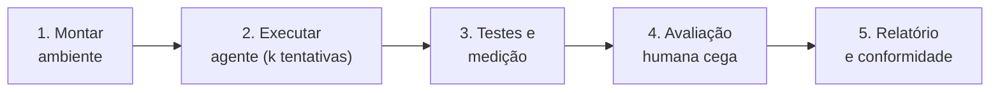

# Proposta: avaliar agentes de IA em experiências físicas, internamente

**Versão:** 0.2 (rascunho) · **Destinatários:** equipes de avaliação, plataforma, SDK e acessibilidade

## 1. Resumo

- **Problema:** uma IA pode entregar código que compila e *afirmar* que a experiência funciona, sem que ela funcione no dispositivo nem seja boa para quem usa.
- **Proposta:** um kit aberto e reproduzível para você medir isso **dentro da sua empresa**, com seus modelos, seu hardware e seus avaliadores.
- **Diferencial:** exige evidência em cinco níveis (V0–V4), usa avaliação humana cega e audita se o que o agente afirmou bate com o que foi comprovado.

## 2. O problema e a lacuna

Benchmarks de programação medem a solução de problemas e a aprovação em testes de software. Em integração com hardware, aparecem falhas que esses testes não pegam:

| Falha típica | Por que passa despercebida |
|---|---|
| Resposta háptica incompatível com o evento | O comando foi enviado; ninguém mediu a resposta |
| Atraso perceptível entre evento e sensação | Só aparece com medição externa ou uso real |
| Recurso "implementado" que o dispositivo não oferece | O agente simulou sem avisar |
| Vibração presa após desconexão | Não há teste de estado seguro |
| Efeito tecnicamente correto, mas desagradável | Só uma pessoa percebe |

## 3. O que o HPIB é e o que não é

| É | Não é |
|---|---|
| Especificação, tarefas, esquemas e protocolos reproduzíveis | Um serviço hospedado ou um ranking público |
| Um kit para execução interna | Uma certificação de dispositivo ou de modelo |
| Começa com controles de videogame (GCEB) | Um benchmark já validado cientificamente |

## 4. Por que interessa a você

| Se você é… | Valor |
|---|---|
| **Laboratório de IA** | Avalia agentes em trabalho com hardware real; mede também honestidade de conclusão (D5), uma falha comum de agentes |
| **Fabricante ou plataforma** | Mostra o quão bem agentes usam seu SDK e seus recursos hápticos; revela lacunas de documentação e de API |
| **Estúdio de jogos ou equipe de acessibilidade** | Mede se a IA consegue criar feedback háptico e opções de acessibilidade utilizáveis |

## 5. O que você faria internamente

Detalhes, papéis e listas de verificação: [INTERNAL-RUN-GUIDE.md](INTERNAL-RUN-GUIDE.md). Uma **execução mínima** usa 1 tarefa, 2 configurações, 3 tentativas e 3 avaliadores, sem bancada de medição.

## 6. O que este repositório já entrega e o que ainda falta

| Já entrega | Ainda falta (ver [ROADMAP](ROADMAP.md)) |
|---|---|
| Especificação do HPIB e do GCEB | Aplicação de referência e harness de testes |
| Tarefa `terrain-feedback` em YAML, com 16 requisitos, 2 extras condicionais e 12 testes | Bancada de medição V3 documentada |
| Pontuação com portões, fórmulas e estatística | Calibração de pesos e limiares em piloto |
| Protocolo humano com âncoras e medida de concordância | Verificação dos recursos de hardware (Fase 1) |
| Esquemas, modelos e exemplos | Variantes privadas da tarefa (conjunto de retenção) |

## 7. Trabalhos relacionados

| Trabalho | O que faz | Diferença do HPIB |
|---|---|---|
| Benchmarks de código (por exemplo SWE-bench, HumanEval) | Testes de software sobre código | Sem hardware nem percepção humana |
| IoT-SkillsBench ([arXiv:2603.19583](https://arxiv.org/abs/2603.19583), mar. 2026) | 42 tarefas de sistemas embarcados e IoT, validadas em 3 plataformas reais, 23 periféricos | Foco em embarcados; não avalia experiência humana nem háptica perceptiva |

Até onde sabemos, e sujeito a revisão sistemática da literatura ainda não feita, nenhum benchmark público combina hardware real, háptica perceptiva, avaliação humana cega e auditoria de afirmações. Contribuições com referências são bem-vindas.

## 8. O que pedimos e o que não pedimos

- **Pedimos:** feedback técnico por *issues*; opcionalmente, citar o HPIB e usar o modelo de relatório se publicar resultados.
- **Não pedimos:** exclusividade, dados, código, nem a publicação de resultados.

## 9. Riscos e limitações

| Risco | Mitigação proposta |
|---|---|
| Ruído da avaliação humana | Painel, âncoras de referência, α de Krippendorff ([HUMAN-EVALUATION](HUMAN-EVALUATION.md)) |
| Variação de hardware | Pontuação condicionada às capacidades verificadas |
| Poucas amostras | k ≥ 5 tentativas e intervalos de confiança; sem ranking com intervalos sobrepostos |
| Memorização da tarefa pública | Variantes privadas, geração paramétrica e *canary* |
| Execução interna não comparável | Níveis de conformidade C0–C2 |

## 10. Contato

`[nome, e-mail ou perfil do autor]`
