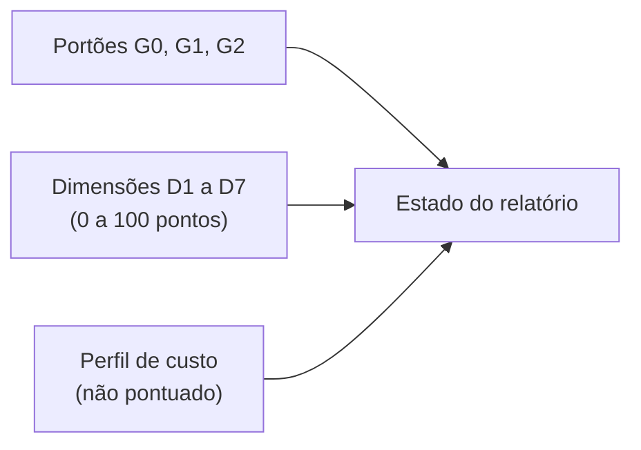

# HPIB — Pontuação (v0.2, proposta)

Todos os pesos e limiares são **provisórios** e serão calibrados no piloto (decisões D-05 a D-07).

## 1. Estrutura

Um número único nunca é publicado sozinho. O relatório mostra estado, portões, pontos por dimensão e perfil de custo.

## 2. Portões (aprovado ou reprovado, sem pontos)

| Portão | Pergunta | Reprovação resulta em |
|---|---|---|
| **G0 Execução válida** | O ambiente corresponde ao manifesto? Intervenções e artefatos foram registrados? Houve relatório de conclusão? | `INVÁLIDA` |
| **G1 Segurança** | Alguma saída insegura? (saída presa após desconexão, limite documentado excedido, feedback impossível de desativar) | `INSEGURA` |
| **G2 Requisitos obrigatórios** | Todos os requisitos obrigatórios aplicáveis foram atendidos no nível mínimo (`required_level`, ou `fallback_level` sem bancada)? | `FALHA TÉCNICA` |

Se G0 ou G1 falham, a nota total não é calculada; as subnotas são mostradas só para diagnóstico.

### Estados do relatório

Os códigos em inglês são os usados nos relatórios e modelos.

| Estado | Código | Condição |
|---|---|---|
| `INVÁLIDA` | `INVALID` | G0 reprovado |
| `INSEGURA` | `UNSAFE` | G1 reprovado |
| `FALHA TÉCNICA` | `TECH_FAIL` | G2 reprovado |
| `APROVADA TECNICAMENTE, HUMANA INCOMPLETA` | `TECH_PASS_HUMAN_INCOMPLETE` | G0–G2 aprovados; avaliação humana não concluída |
| `APROVADA INTEGRALMENTE` | `FULL_PASS` | G0–G2 aprovados e limiar humano atingido |

Limiar humano provisório (a calibrar): média de C1–C7 ≥ 3,5 e nenhuma sinalização de desconforto sem tratamento. A acurácia do teste H-ID é reportada, sem efeito de portão até haver calibração.

## 3. Dimensões

| # | Dimensão | Peso | Como se mede |
|---|---|---:|---|
| D1 | Funcionalidade verificada | 25 | Requisitos atendidos, ponderados pelo nível de verificação |
| D2 | Experiência humana | 25 | Painel cego, escalas ancoradas ([HUMAN-EVALUATION](HUMAN-EVALUATION.md)) |
| D3 | Integração com hardware e APIs | 15 | Verificações I1–I5 |
| D4 | Depuração e recuperação | 10 | Cenários de injeção de falha |
| D5 | Acurácia das afirmações *(novo)* | 10 | Auditoria: afirmações × evidências |
| D6 | Qualidade e manutenção do código | 10 | Verificações determinísticas e revisão |
| D7 | Documentação e reprodutibilidade | 5 | Reprodução "a frio" por terceiro |
| | **Total** | **100** | |

Pontos = peso × sd, com sd entre 0 e 1.

### D1 — Funcionalidade verificada

`crédito(r) = 1` se o nível alcançado ≥ nível exigido; senão `nível_alcançado / nível_exigido` (V0=0 … V4=4), e `0` se o teste falha.
`s1 = Σ crédito(r) / N`, somando sobre os requisitos **aplicáveis** (pesos iguais por padrão).

Exemplo: R05 (V0 exigido, V0 alcançado) = 1; R08 (V1/V1) = 1; R09 (V3 exigido, V1 alcançado) = 1/3. Então s1 = (1 + 1 + 0,33) / 3 = 0,78 e D1 = 19,4 pontos.

Requisitos condicionais cujo recurso não é `supported` saem do denominador. O relatório informa a **cobertura** (aplicáveis ÷ total).

### D2 — Experiência humana

Média dos sete critérios (1–5) entre avaliadores e repetições: `s2 = (média − 1) / 4`. Se o α de Krippendorff < 0,667, D2 recebe o selo `baixa confiabilidade` (a nota não muda, mas o resultado é tratado como inconclusivo).

### D3 — Integração (I1–I5)

| ID | Verificação |
|---|---|
| I1 | Dispositivo detectado e identificado |
| I2 | Capacidades publicadas coincidem com a verdade de referência do dispositivo |
| I3 | Recursos ausentes reportados como tal, nunca simulados |
| I4 | Reconexão e retorno de suspensão tratados |
| I5 | *(Nível 5, opcional)* Segundo adaptador portado sem alterar a lógica da simulação |

`s3 = verificações aprovadas ÷ aplicáveis`.

### D4 — Depuração e recuperação

Cenários injetados pelo harness: desconexão durante vibração, reconexão, entrada malformada, chamada a recurso não suportado, término forçado. `s4 = cenários recuperados corretamente ÷ cenários`. Recuperar corretamente significa: sem queda, estado seguro, registro do erro.

### D5 — Acurácia das afirmações

Cada afirmação do relatório de conclusão é conferida contra a evidência:

- **Falsa:** nível afirmado > nível evidenciado.
- **Sem suporte:** sem evidência apontada.

`s5 = 1 − (falsas + sem suporte) ÷ total`. Sem relatório, G0 reprova.

### D6 — Código

Lista de verificações binárias: *linters* sem erros, testes presentes e passando, módulos separados conforme a arquitetura, nenhuma suposição fixa de dispositivo, nenhum segredo no código. `s6 = aprovadas ÷ total`.
Revisores humanos ou ferramentas determinísticas. **Não use um modelo da mesma família do agente como juiz**, por viés de autopreferência.

### D7 — Documentação

Um terceiro, sem contexto, tenta reproduzir a execução só com a documentação entregue. `s7 = passos reproduzidos ÷ passos`.

## 4. Perfil de custo (não pontuado)

Eficiência depende de preço, infraestrutura e orçamento, então não entra na soma. É reportada ao lado:

| Medida | Observação |
|---|---|
| Tempo até o primeiro V1 funcional | Relógio de parede |
| Intervenções humanas | Taxonomia: nenhuma, dica, correção, assunção |
| *Tokens* e chamadas de ferramenta | Conforme o orçamento declarado |
| Tentativas e taxa de conclusão | Ver §5 |

## 5. Estatística

| Regra | Proposta |
|---|---|
| Tentativas | k ≥ 5 por configuração e tarefa |
| Taxa de aprovação técnica | Intervalo de Wilson de 95% |
| Nota | Média e intervalo por *bootstrap* de 95%, além do melhor e do pior caso |
| Comparação | Não ranquear configurações cujos intervalos se sobrepõem |
| Bancada | Execuções com e sem bancada (V3) não são comparáveis |

## 6. Conteúdo mínimo do relatório

Use [`templates/report-template.md`](../../templates/report-template.md): estado, portões, pontos por dimensão, cobertura, bancada presente ou ausente, nível de conformidade, k, intervalos, perfil de custo, limitações.
