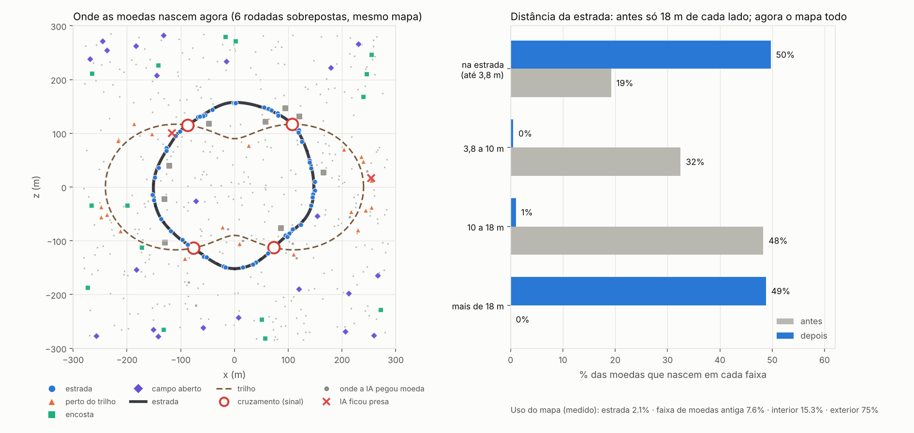

# Carrinho vs IA

Corrida de coleta de moedas contra uma IA. Three.js, visual low-poly, controle PS5 com vibração.

## Como rodar

ES modules não funcionam abrindo o `index.html` direto do disco. Use um servidor local:

```bash
npx --yes serve -l 5173 .
# abra http://localhost:5173
```

Use Chrome ou Edge em `http://localhost` ou HTTPS. Para vibração WebHID, conecte o DualSense por cabo USB.

## Controles

| Ação | Controle PS5 | Teclado |
|---|---|---|
| Dirigir | Analógico esquerdo | A / D ou setas |
| Acelerar | R2 | W / ↑ |
| Frear; parado, dar ré | L2 | S / ↓ |
| Freio de mão (derrapar) | Quadrado ou R1 | Espaço |
| Voltar à pista (custa 1 moeda, espera 3 s) | Triângulo | R |
| Girar a câmera | Analógico direito | Q / E |
| Olhar para trás | R3 | C |
| Pausar / continuar; começar / reiniciar | Options | P ou Esc / Enter |
| Painel de vibração / vibração de teste | — | F2 / F3 |

O jogo pausa sozinho se você trocar de aba.

### Como o controle foi ajustado

| Ponto | Antes | Agora |
|---|---|---|
| Zona morta | 0,2 por eixo (diagonais travavam) | 0,14 radial, reescalada (sem "pulo" ao sair do centro) |
| Curva do analógico | linear | expoente 1,5 (`vehicle.steerExp`): centro fino, extremo rápido |
| Direção em alta velocidade | giro fixo (derrubava o carro) | taxa cai com a velocidade: aceleração lateral nunca passa de 1,6 g |
| Ré | só por teclado | L2 parado por 0,25 s |
| Teclado | direção 0 ou 1 de uma vez | rampa de ~0,2 s |
| Batida em poste/árvore | velocidade ×0,4 a cada quadro (grudava) | só perde a parte que entra no obstáculo e desliza |
| Borda do mapa | velocidade ×0,3 por quadro | desliza ao longo da borda |
| Câmera | fixa atrás do carro | analógico direito, R3, campo de visão abre com a velocidade |
| Vibração | superfície e relevo | + aviso de trem, batida (força pelo impacto), derrapagem, moeda (por valor) |

Todos os números estão em `CONFIG.input`, `CONFIG.vehicle` e `CONFIG.camera`.

## Vibração: como testar

A vibração depende do navegador e do controle. O jogo mostra o diagnóstico no painel (F2):

1. Clique em **Começar**. Se a Gamepad API não expuser vibração, o navegador abre um seletor de dispositivo WebHID. O botão **Conectar DualSense USB** permite tentar novamente.
2. Selecione o DualSense autorizado e conecte-o por **USB**. A primeira conexão pede permissão; as próximas reutilizam essa autorização.
3. Abra **F2**: deve aparecer `WebHID USB conectado`. **F3** dispara o teste; falhas aparecem em `último erro`.
4. Bluetooth ainda não é suportado no caminho WebHID deste projeto.

Se o atuador estiver disponível e você ainda não sentir nada, o problema está na intensidade ou na própria via de 2 motores (ver "Limites").

### Parâmetros hápticos

Os efeitos ficam em `HAPTIC_PARAMS` em `src/haptics/haptics.js`; a vibração contínua por superfície fica em `SURFACES` em `src/core/config.js`. Intensidades vão de 0 a 1 e duração é em milissegundos.

| Efeito | Grave | Agudo | Duração |
|---|---:|---:|---:|
| Teste/colisão forte | 1,00 | 1,00 | 500 ms |
| Voltar à pista | 0,30 | 0,30 | 120 ms |
| Batida | 0,35 + impacto/14 | 0,70 | 160 ms |
| Moeda | 0,10 + valor×0,05 | 0,50 + valor×0,10 | 70 + valor×25 ms |
| Superfície/relevo | conforme superfície e velocidade | conforme superfície/clima/derrapagem | 120 ms, repetido a cada 100 ms |

## Arquitetura

As partes conversam por contratos e eventos. Nenhuma camada conhece os detalhes de outra.

```
CAMADA 1: Regras       Match (tempo, placar, rodadas)
                           │ controla
CAMADA 2: Simulação    Terreno ◄── consulta ── Veículos ── colide ── Trem (distância real)
                       (relevo suavizado,      ▲ (Driver: jogador ou IA)   │
                        estrada, trilho,       │ ◄── sinais (verde/aviso/vermelho)
                        obstáculos, moedas     │
                        por zona)              │
                       └──── Clima ────────────┘ (atrito, visibilidade)
                           │ eventos: coin:collected, vehicle:crash, vehicle:bump,
                           │          vehicle:reset, match:pause, weather:change
CAMADA 3: Apresentação Háptica · Câmera · HUD · render/* (Three.js)
```

### Relevo, estrada e trilho

- O relevo fora da pista é o ruído natural (`rawHeight`).
- Um **relevo suavizado** (`Ground`) é pré-calculado sobre uma grade e alisado com média de 28 m.
- Estrada e trilho se assentam nesse relevo suavizado, e o terreno se molda a eles nas margens.
- Resultado: a inclinação do trilho fica em ~4,4% e da estrada em ~8%, e nos cruzamentos as duas bases ficam à mesma altura (diferença de 1 cm). O terreno fora da pista continua variado.

### Pastas

```
index.html            página, tela inicial e importmap do Three.js
src/
├── core/             config.js (todos os números), events.js, random.js
├── world/            noise, ground (relevo suavizado), terrain, coins, train, props
├── vehicles/         vehicle (física), drivers (jogador e IA)
├── input/            teclado e controle PS5
├── haptics/          vibração por superfície, relevo e clima + diagnóstico
├── gameplay/         match (rodadas, placar, regras)
├── ui/               hud (DOM)
├── render/           só desenho: terrainView, trackView, propsView, trainView,
│                     vehicleView, coinView, sky, weatherView, materials
└── main.js           monta tudo e roda o loop
tests/logic.test.js   testes da lógica (sem navegador)
```

`world/`, `vehicles/`, `gameplay/` e `core/` não importam Three.js. Isso permite testar a lógica no Node e trocar a visual sem mexer nas regras.

### Trem

- A cabeça anda pelo trilho. Cada carro tem frente e traseira sobre o trilho, e daí saem rumo, **inclinação** (sobe e desce) e **rolagem** (desnível entre os trilhos).
- A cabeça anda por **distância real** sobre o trilho (`train.s`, em metros), a 20 m/s em qualquer ponto. Antes avançava o ângulo e chegava a ~27 m/s no trecho mais afastado do "8".
- `train.signals()` diz, para cada cruzamento, se está `green`, `warn` (trem chega em até 6 s) ou `red` (trem passando). A IA freia nesses sinais, o HUD avisa o jogador, o controle vibra e os sinais piscam no cenário.
- Cada **eixo** fica sobre o trilho no seu próprio ponto. Assim as rodas encostam no trilho mesmo em curvas.
- As rodas giram conforme a distância percorrida.

### Modo de desenvolvimento

`index.html?dev` expõe `window.game` (estado do jogo) e permite câmera livre (`game.setDevCam`). Não afeta quem joga normalmente.

## Escala de referência

1 unidade = 1 metro.

| Item | Tamanho (aprox.) | Observação |
|---|---|---|
| Carro | 4,0 × 1,8 × 1,7 m | |
| Casa | 6 × 5 × 5,8 m | referência para o resto |
| Pinheiro | 6 a 10 m | |
| Carvalho | 6 a 9 m | |
| Poste de luz | 6,3 m | |
| Poste de telégrafo | 8 m | |
| Locomotiva | 16 m | |
| Vagão | 12 m | |
| Bitola | 1,435 m (trilhos a ±0,72 m) | padrão real |
| Moeda | diâmetro 1,8 m | **exagerada de propósito**, para ficar legível de longe |

## Como modificar cada elemento

| Quero mudar... | Onde mexer |
|---|---|
| Amplitude e largura do relevo | `CONFIG.terrain` (`heightScale`, `noiseScale`, `groundBlur`) |
| Largura ou curvatura da estrada | `CONFIG.road` |
| Forma do trilho ou cruzamentos | `CONFIG.rail` (`radiusBase`, `radiusAmp`) |
| Brita, dormentes, bitola | `CONFIG.rail` |
| Velocidade, aceleração, freio, suspensão | `CONFIG.vehicle` |
| Velocidade, vagões, posição dos eixos | `CONFIG.train` (`cars`, `wheelsets`) |
| Atrito, velocidade e vibração por superfície | `SURFACES` em `core/config.js` |
| Climas (céu, neblina, chuva, neve, noite) | `WEATHER` em `core/config.js` |
| Onde as moedas nascem e quanto valem | `CONFIG.coins.zones` (pesos), `hillSlope`, `riskDistance` e `coinValue` em `SURFACES` |
| Zona morta, curva e suavização do controle | `CONFIG.input` e `vehicle.steerExp` |
| Câmera (distância, campo de visão, giro) | `CONFIG.camera` |
| Sinais do trem | `CONFIG.train.warnSeconds`; visual em `render/roadsideView.js` |
| Quantidade de árvores, casas, pedras | `CONFIG.props` |
| Dificuldade da IA | `CONFIG.ai` (`levels`, `defaultLevel`, `coinSight`, `rubberLead`, `rubberTrail`) |
| Comportamento da IA | `AIDriver` em `vehicles/drivers.js` (mesma interface do jogador) |
| Regras de placar e penalidade | `gameplay/match.js` |
| Intensidade e padrão da vibração | `haptics/haptics.js` |
| Aparência de carro, trem, casa, árvore | `render/*View.js` (não afeta a lógica) |

Para trocar uma peça por outra, basta respeitar o contrato. Por exemplo, um novo Driver precisa apenas de `controls(vehicle, dt)` devolvendo `{ throttle, brake, steer }`.

## Convenções

- Direção: `heading = 0` aponta para +Z. Vetor da direção: `(sin h, cos h)`.
- `steer > 0` é para a esquerda.
- Simulação em passo fixo de 1/60 s (`STEP` em `main.js`).
- `pitch` positivo: frente mais alta. `roll` positivo: direita mais alta.

## Limites conhecidos

- **Vibração:** o jogo usa os dois motores padrão. Usa Gamepad API quando disponível e WebHID USB como alternativa no DualSense; háptica avançada dos gatilhos e Bluetooth WebHID ainda não estão implementados.
- **Testes com controle:** não há controle no ambiente de desenvolvimento. A vibração foi verificada só até o ponto de diagnóstico.
- **Trem e carro:** a colisão usa três pontos por vagão e raio fixo. É suficiente para o protótipo.
- **IA:** escolhe a moeda por valor/distância, desvia de obstáculos e freia nos sinais, mas não tem navmesh. Em simulação ficou presa ~2 vezes por partida (1 a 3 s cada) e se recupera sozinha (ré cada vez mais longa, abandona a moeda).
- **Cruzamento:** os sinais piscam, mas não há cancela nem ponte. O trem continua sendo um perigo real.
- **WebHID:** requer Chrome/Edge, contexto seguro (localhost ou HTTPS), permissão explícita e conexão USB. Não foi possível validar a vibração em hardware nesta sessão.

## Testes

```bash
npm test          # 35 testes de lógica + checagem das malhas visuais
npm run analise   # mede o mapa e escreve docs/analise-mapa.json
python3 tools/plot-map.py   # desenha docs/mapa-analise.png
```

Cobertura: relevo reproduzível, inclinação de trilho e estrada, cruzamentos, eixos sobre o trilho, trem com velocidade constante, sinais coerentes com a colisão, zona morta e curva do analógico, mapeamento do DualSense com controle falso, ré, batida deslizante, limite de aceleração lateral, freio de mão, moedas por zona, IA (níveis, elástico, parada no sinal), pausa e "voltar à pista".

## Análise do mapa

`tools/map-analysis.mjs` trata o mapa como espaço de jogo e mede: uso do espaço, onde as moedas nascem, quem pega o quê (IA em 8 mapas × 210 s), exposição ao trem, visibilidade das moedas e obstáculos na pista. Resultado e decisões: `docs/analise-mapa.md`. Valores de antes: `docs/analise-antes.json`.


